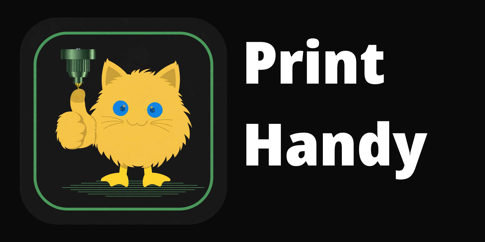

  

# Print Handy

**Prepare and manage 3D prints right from your chat — Discord, Telegram or Matrix — and nothing ever prints without your explicit confirmation.**

Current release: **2.1.6**

[Get started](#quick-start-docker) · [Documentation](https://catduckgnaf.github.io/print-handy-docs/) · [Contribute](CONTRIBUTING.md) · [Releases](https://github.com/catduckgnaf/print-handy/releases)

## How it works

1. **Share a model.** Drop a MakerWorld, Printables or Thingiverse link in the chat, or upload an STL or 3MF file. MyMiniFactory links are checked for their file inventory only; downloads are not supported yet.
2. **Make a few choices.** Print Handy walks you through colors and filament, fit and layout, then slices the model for your printer.
3. **Check and confirm.** You see the result before anything happens. Only when you approve it does Print Handy send the job to a configured printer.
4. **Follow along.** Progress, alerts and timelapses come back to the same chat.

That's the whole idea: the convenience of printing from chat, with a human — you — making the final call every time.

## Quick start (Docker)

Docker is the easiest way to run Print Handy. One container does everything:

| Part | What it does |
|---|---|
| Chat bot | Your interface: links, uploads, guided slicing, spool commands and print confirmation |
| Moonraker listener | Follows your printer and reports progress, alerts and timelapses to the chat |
| Spoolman API | A bundled Spoolman 0.27.0 backend that keeps your filament and spool records. Print Handy is its interface — there is no separate Spoolman web UI, and the API only listens inside the container |

If any part stops, the container stops so Docker can restart it, and the health check covers all three. The box also includes OrcaSlicer (stable and alpha channels), Bambu Studio (the default slicer for Bambu Lab printers) and OpenSCAD for CAD splitting.

**You need:** a Raspberry Pi 4 or 5 with 64-bit Raspberry Pi OS, or any 64-bit Debian or Ubuntu machine. The image (`ghcr.io/catduckgnaf/print-handy`) is published for `linux/amd64` and `linux/arm64`.

1. Copy `.env.example` to `.env` and fill in the bot token and channel (or room) for your chat platform. Discord is the default; set `PRINT_HANDY__BOT__PLATFORM` for Telegram or Matrix. You can leave the allowed-users list empty — then everyone in the print channel can use the bot.
2. Set `PRINT_HANDY_IMAGE` to the image. Pinning by digest is recommended; the digest for each release is in its release notes, and the [Docker guide](docs/DOCKER.md) shows the exact format.
3. Set `PRINT_HANDY_DATA` to a folder that survives restarts, owned by UID 1000. Spoolman data lives in its `spoolman` subfolder unless you set `PRINT_HANDY_SPOOLMAN_DATA`.
4. Run `docker compose up -d`.

That's it. The [Docker guide](docs/DOCKER.md) covers health checks, upgrades, rollback and the full platform matrix.

- **Already run your own Spoolman?** Point `PRINT_HANDY__SERVICES__SPOOLMAN_URL` at it and set `PRINT_HANDY_BUNDLED_SPOOLMAN=false`. Nothing is migrated either way.
- **On Unraid?** Start from `docker/unraid/print-handy.xml`.

### Prefer not to use Docker?

There are two manual routes, both needing Python 3.11 or newer:

- The [standalone bot](docs/STANDALONE.md) runs on Discord — or on [Telegram](docs/TELEGRAM-BOT-SETUP.md) or [Matrix](docs/MATRIX-BOT-SETUP.md) instead — without Hermes.
- The [Hermes installation](docs/INSTALL.md) is for existing Hermes users on Discord.

Then use the [configuration guide](docs/CONFIGURATION-YAML.md) to set your printer model, chat channel, authorized users, service addresses and slicer. Before you enable printing, double-check the printer profile, bed size, nozzle and filament — and start with the installation guide, not a production print. The setup doctor can help, but note it contacts your configured services; it is not an offline-only check.

One thing to know either way: slicing needs a compatible OrcaSlicer and the right printer, process and filament profiles. The Docker image bundles its slicers; a Python install alone does not provide one.

## Is my printer supported?

| Printer | Notes |
|---|---|
| **Flashforge AD5X, AD5M, AD5M Pro, Creator 5 and Creator 5 Pro** (with ZMod) | Built-in profiles; the Creator models have four toolheads each. See [ZMod printers](docs/ZMOD.md). |
| **Flashforge AD5X on stock firmware** | Built-in profile over the printer's LAN HTTP API — no Moonraker, no ZMod. See [Stock Flashforge printers](docs/FLASHFORGE-STOCK.md). |
| **Sovol SV06** | Built-in profile, sliced with OrcaSlicer. |
| **Prusa MK4S, CORE One, XL and MINI+** | Slicing plus opt-in PrusaLink LAN status, upload and gated print start. See [Prusa printers](docs/PRUSA.md). |
| **Elegoo Neptune 4, 4 Pro, 4 Plus and 4 Max** | Built-in profiles over Moonraker. See [Elegoo printers](docs/ELEGOO.md). |
| **Elegoo Centauri Carbon** | SDCP LAN, opt-in. See [Elegoo printers](docs/ELEGOO.md). |
| **Qidi Q1 Pro, X-Plus 3, X-Max 3 and X-Smart 3** | Built-in profiles over Moonraker. See [Qidi printers](docs/QIDI.md). |
| **Creality Ender-3 V3, V3 KE, V3 Plus, K1, K1C and K1 Max** | Built-in profiles over Moonraker (Creality OS). Creality's Marlin printers are not in this row — they use the OctoPrint route below. See [Creality printers](docs/CREALITY.md). |
| **Bambu Lab A1, A1 mini, P1P, P1S, P2S, X1, X1 Carbon, X1E, H2S and A2L; dual-nozzle H2D, H2D Pro, H2C and X2D** | Slicing, G-code checks and Bambu packaging, with opt-in LAN status, upload and gated print start (the dual-nozzle models with per-slot AMS mapping at print start). Bambu printers slice with Bambu Studio by default; set `printer.slicer: orca` to use OrcaSlicer instead. None of these has been tested on Bambu hardware. See [Bambu Lab printers](docs/BAMBU-LAB.md). |
| **Any other Klipper printer** | A generic Klipper/Moonraker adapter is included — but a generic adapter is not a tuned or physically verified profile for your printer. |
| **Marlin printers behind OctoPrint** (including the older Ender and CR lines) | A generic OctoPrint/Marlin adapter is included, plus built-in presets for the Creality Ender-3, Ender-3 Pro, Ender-3 V2 and Ender-3 V3 SE with their real dimensions. See [OctoPrint + Marlin](docs/OCTOPRINT-MARLIN.md). |

Some profiles can also offer chat file delivery or an offline Bambu package after slicing; delivery never authorizes printing, and Bambu packaging is not verified in Bambu Studio or on hardware. Details are in [printer profiles](docs/PRINTER-PROFILES.md).

## Which chat platform?

The same bot, with the same prompts and safety gates, runs on **Discord, Telegram or Matrix** — only the transport changes. Setup: [Discord](docs/DISCORD-BOT-SETUP.md) · [Telegram](docs/TELEGRAM-BOT-SETUP.md) · [Matrix](docs/MATRIX-BOT-SETUP.md).

- On Discord you can alternatively run Print Handy as a Hermes plugin instead of the standalone bot. Use only one mode with a given bot token.
- The Telegram and Matrix bots are pure bots with no LLM: send a message that isn't a command and you get the command list back.

## What you can do

- **Prepare models.** Links and uploads go through guided choices for colors, fit, supported layouts and slicing. Some models need your judgement along the way — not every shape has a validated automatic placement or cut strategy.
- **Design a part in chat.** `/print-design` (or `/design`) turns a plain-language description into an OpenSCAD part, shows you a preview with the real dimensions, and lets you ask for changes (up to 10 turns) before it joins the normal prepare-and-confirm flow. Works on Discord, Telegram and Matrix whenever a model endpoint is configured. See [AI design](docs/DESIGN.md).
- **Manage filament.** Spoolman and supported IFS integrations keep spool identity and material consistent. If a print pauses on filament runout, the spool question the bot posts has a **Cancel print** button (or accepts a typed `cancel the print`), so you can always stop the print without answering the question first.
- **Run approved jobs.** Confirm bed clearance, work through multi-plate plans, and reprint archived jobs — all behind the same guarded controls.
- **Follow a print.** Configured printer events and timelapses post back to your chat, and every job is recorded.
- **Get help in chat.** `/print-handy setup` walks a fresh install through a saved, resumable checklist (nothing is written without an explicit `apply`), and `/print-handy debugging` runs read-only, redacted checks. See [guided setup and debugging](docs/GUIDED-SETUP-DEBUGGING.md). If you need to file a bug report, `/print-handy bundle` assembles a diagnostics bundle — versions, a redacted configuration summary (secret values are never included), printer summary, doctor output and a bounded tail of recent logs — as a local file that only leaves the machine if you choose to attach it. See [diagnostics](docs/DIAGNOSTICS.md).
- **Use the optional Web UI.** An off-by-default local status page and picker configuration page for the same settings file. See the [Web UI guide](docs/WEBUI.md).

### Camera watchdog

While a print runs, Print Handy keeps an eye on the printer camera — at layer 2, layer 5 and then periodically — and a vision model classifies each frame. If it sees spaghetti, a detached part, an empty bed, a stalled print, or a frame it can't classify, it posts the photo with **Pause** and **It's fine** buttons. Tap Pause, and the paused post offers Resume and Cancel. The watchdog itself never touches the printer — it only alerts; every printer action is your tap.

Tune how readily it alerts with `visual_watch.sensitivity` from 1 (quietest) to 5 (most alerts, default 3), or turn it off with `visual_watch.enabled`. Both are settable in YAML and as Docker environment variables (`PRINT_HANDY__VISUAL_WATCH__SENSITIVITY`, `PRINT_HANDY__VISUAL_WATCH__ENABLED`). It needs a camera snapshot and a vision endpoint (`services.vision_chat_url`; empty disables camera checks). See [camera stall sensitivity](docs/PROJECT-REFERENCE.md#camera-stall-sensitivity) and the [Docker guide](docs/DOCKER.md#camera-watch-visual_watch).

### A little fun: the roast

When printing begins, the print-started post can end with a one-line roast of your model (exactly one per print; completion posts never carry one). Roasts are on by default whenever an LLM/vision endpoint is available, on every platform, and `vision.roast_enabled` (env `PRINT_HANDY__VISION__ROAST_ENABLED`) turns them off without affecting camera checks.

Printer-specific capabilities and the full command list are in the [project reference](docs/PROJECT-REFERENCE.md). Optional vision and conversational features may use a model; the standalone command and slicing workflow does not require one.

## Please read: safety

Print Handy is careful, but it isn't a guarantee:

- A model that fits in a bounding box is not proof of a printable orientation. Check support needs, bed and brim clearance, profile compatibility and the generated G-code before physical use.
- Offline tests are not a live hardware test. Keep the confirmation and artifact guards enabled.
- A camera alert or classification is not a guarantee of safe unattended printing.
- Only use models you are allowed to download and process — and never attach private models, credentials or personal printer logs to a public issue without reviewing them first.

## Find the right guide

| I want to… | Go here |
| --- | --- |
| Install and configure Print Handy | [Documentation site](https://catduckgnaf.github.io/print-handy-docs/) · [Documentation home (source)](docs/README.md) |
| Run Print Handy for two or more printers | [More than one printer](docs/MULTI-INSTANCE.md) |
| Set up the bot on Telegram or Matrix | [Telegram bot setup](docs/TELEGRAM-BOT-SETUP.md) · [Matrix bot setup](docs/MATRIX-BOT-SETUP.md) |
| Look up commands, settings and integrations | [Detailed project reference](docs/PROJECT-REFERENCE.md) |
| Report a problem or contribute | [Contribution guide](CONTRIBUTING.md) · [Issues](https://github.com/catduckgnaf/print-handy/issues) |
| See what shipped in each release | [GitHub releases](https://github.com/catduckgnaf/print-handy/releases) |
| Write or review release notes | [Release-note guide](docs/RELEASE-NOTES.md) · [Internal history](docs/INTERNAL_RELEASE_NOTES.md) |

Draft pull requests describe pending work, not installed or released capabilities.
